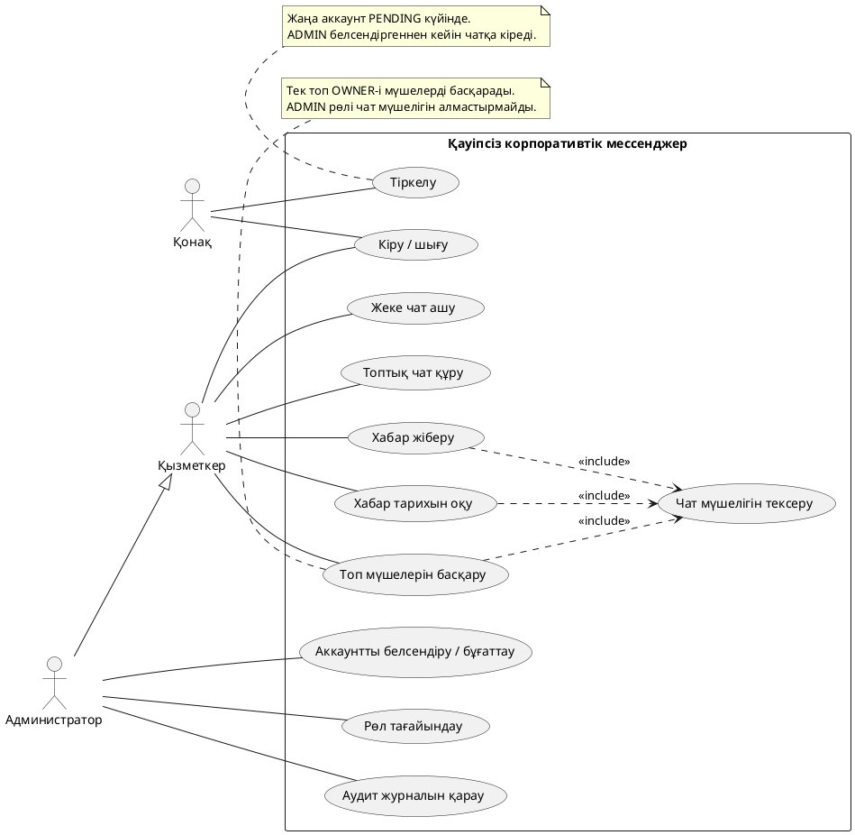
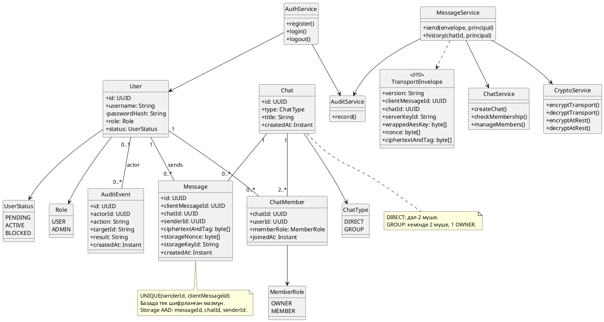

# [UML 1] Use Case және Class — 3-адам

Дереккөз: https://trello.com/c/SjTGbOde

2026-11-20 күнгі Trello материалдарының көшірмесі. Бұл бұрынғы жоспар: ондағы «осы апта» және аяқталу жөніндегі мәтін нақты код күйін растамайды. Іске асырылған мүмкіндіктер README-де көрсетіледі.

## Жауапты: 3-адам — UML
Use Case пайдаланушылардың әрекеттерін, Class жүйенің деректерін көрсетеді. Тексеруші: 1-адам.
GitHub: https://github.com/ergasaylaubay/SecurityTeam

## Use Case
Қонақ тіркеледі және кіреді. Қызметкер жеке/топтық чатпен жұмыс істейді. ADMIN аккаунт, рөл және аудитті басқарады; бұл бөтен чаттарды оқуға автоматты рұқсат бермейді. Топ мүшелерін тек OWNER басқарады.

## Class
User мен Chat арасындағы көп-көп қатынас ChatMember арқылы беріледі. TransportEnvelope — тасымалдау объектісі; Message базада шифрланған мазмұнды сақтайды. Бұл сенімді сервер моделі, E2EE емес.

## Тапсыру реті
1. Әр кодты @startuml-дан @enduml-ға дейін бөлек көшіріп, PlantUML редакторында ашу.
2. Use Case және Class диаграммаларын PNG/SVG түрінде экспорттау.
3. Суреттер мен өңделетін кодты осы карточкаға тіркеу.
4. 1-адаммен талаптар, рөлдер және байланыстарды тексеру.
5. Түзетілген нәтижені Code Review-дан Готово-ға өткізу.

Диаграмма редакторы: https://www.plantuml.com/plantuml/uml/umls
Бұл бастапқы нұсқа: диаграммалар суретке экспортталып, командамен тексерілгеннен кейін ғана тапсырма аяқталды деп белгіленеді.

