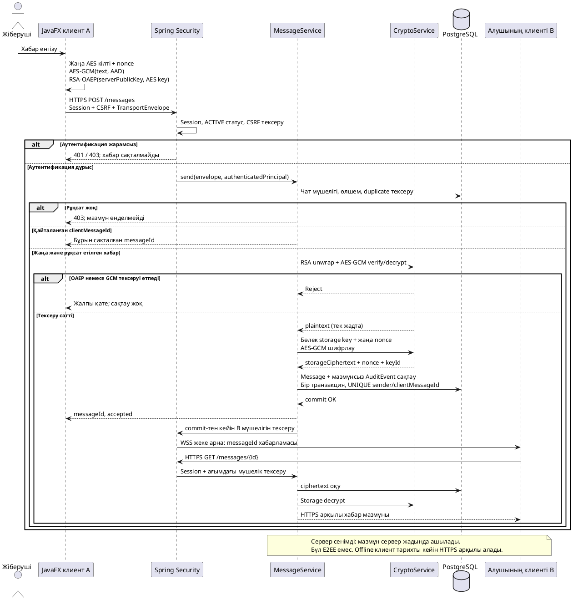
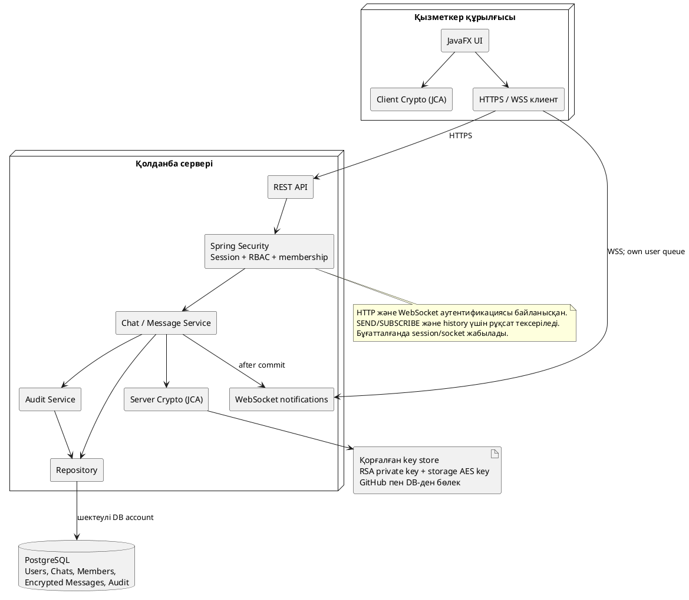

# [UML 2] Sequence және Component диаграммалары

Дереккөз: https://trello.com/c/d6GFCmWh

2026-11-20 күнгі Trello материалдарының көшірмесі. Бұл бұрынғы жоспар: ондағы «осы апта» және аяқталу жөніндегі мәтін нақты код күйін растамайды. Іске асырылған мүмкіндіктер README-де көрсетіледі.

## Sequence түсіндірмесі

Алдын ала шарт: A және B тіркелген, ACTIVE, чат мүшелері; A сервердің public key мәнін алған. Сценарий жаңа хабарды шифрлаудан бастап алушының оқуына дейін барады. 401/403, duplicate және GCM failure тармақтары бар. Алушы offline болса, хабар DB-де қалады, кейін history арқылы оқиды. Қайталанған ID мен өзгертілген payload үшін 409 conflict ережесін іске асыруда қосу қажет.

## Component түсіндірмесі

Клиент JavaFX UI, JCA және HTTP/WSS байланысынан тұрады. Сервер Security, бизнес логика, криптография, аудит және repository модульдеріне бөлінген. Key store DB/GitHub-тан бөлек. Notification тек DB commit-тен кейін жіберіледі. History endpoint әр оқуда рұқсатты қайта тексереді.

## Қамту

FR-04: клиент AES-GCM + RSA-OAEP; сервер unwrap/decrypt және storage encryption.
FR-05: HTTPS/WSS; FR-06: session/role/membership; FR-07: AuditService.
Бұл сенімді сервер моделі; E2EE ретінде таныстырылмайды.

## Аяқтау критерийі

Екі диаграмма экспортталып тіркелді; success/error жолдары түсіндірілді; кілт пен plaintext қай жерде болатыны анық; Research 2 және UML 1 кластарымен сәйкестік тексерілді.

## Осы аптадағы тәртіп

Бұл — команда тексеріп, өз сөзімен түсіндіріп, бекітетін бастапқы нұсқа. Дайын деп автоматты белгіленбейді.
To Do → In Progress → Code Review → Готово. Осы аптада Code Review бағанында зерттеу мен UML де тексеріледі.
GitHub: [https://github.com/ergasaylaubay/SecurityTeam](https://github.com/ergasaylaubay/SecurityTeam "smartCard-inline")
Код жұмысы басталғанда сәйкес Issue/branch/PR сілтемесін қосу. Құжаттар мен диаграммалар Trello-да сақталады.

